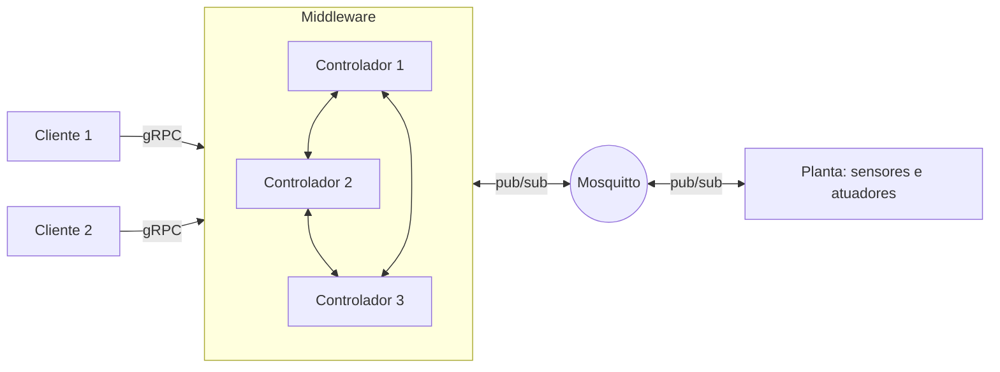

# 1º Trabalho Prático de Sistemas Distribuídos

Aluno: Rodrigo Augusto Correa Soares  
RA: 0100782

## Tema

Uma linha de produção de boosters de Magic: The Gathering. As cartas passam por um leitor que identifica a raridade, e o controlador monta cada booster com 10 comuns, 3 incomuns e 1 rara ou mítica. O booster completo vai para a seladora e depois para a balança. Se o peso não bate, ele é rejeitado, porque saiu com carta a mais ou a menos. O controlador também acompanha o clima e pausa a linha se a umidade passar de 65%, porque papel úmido estraga as cartas.

## Arquitetura

- Broker: Mosquitto.
- Sensores (publicam): leitor de cartas, balança e clima.
- Atuadores (assinam): esteira, seladora e rejeitador.
- Controladores: 3 processos Node.js, cada um salvando o estado no próprio arquivo em `data/`.
- Comunicação baseada em objetos: gRPC. O cliente chama métodos remotos (`GetStatus`, `StartBatch`, `PauseLine`, `ResumeLine`) definidos em `proto/factory.proto`, e os controladores conversam entre si pelo método `Heartbeat`.
- Cliente: painel no terminal, atualizado a cada segundo, que também envia comandos.

## Replicação

Só o líder toma decisões. Para cada mudança, ele monta o novo estado e envia para as réplicas. A mudança só vale quando a maioria (2 de 3) confirma que gravou. Depois disso, o líder grava também e aciona os atuadores. O líder também manda o estado completo nos heartbeats, a cada 500 ms, então um controlador que volta depois de cair se atualiza sozinho.

Se sobrar só um controlador, ele não tem com quem replicar. Nesse caso ele deixa de ser líder e para de aceitar comandos.

## Tolerância a falhas

Os controladores trocam heartbeat a cada 500 ms. Se o líder some por 1,5 s, os outros elegem um novo: o que tem a versão mais recente do estado, com empate decidido pelo menor id.

O cliente tenta o líder. Se o líder não responde, tenta os outros até achar o novo líder, e assim recebe a resposta positiva mesmo com um controlador fora do ar. Cada comando leva um id que se repete em todas as tentativas, e os ids já executados ficam no estado replicado. Assim, se o líder executou um comando e caiu antes de responder, o novo líder devolve o mesmo resultado sem executar de novo.

## Valores que não conferem

O cliente consulta os 3 controladores e só mostra o estado em que a maioria concorda. Quem responde diferente aparece como divergente. Por isso são 3 controladores: com 2, dá para ver que não batem, mas não para saber qual está certo. Para testar, o controlador pode ser iniciado com `FAULT=lie`, que soma 3 aos boosters aprovados em todas as respostas.

## Limitações

- Um líder invadido que replicasse dados falsos contaminaria as réplicas. Resolver isso exigiria consenso bizantino, com pelo menos 4 controladores.
- O broker é um ponto único de falha.
- Não há TLS nem autenticação no MQTT e no gRPC.
